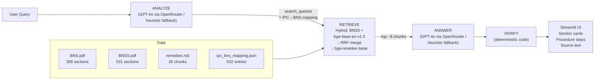

# ⚖️ Legal RAG Chatbot — Indian Criminal Law (BNS & BNSS)

A Retrieval-Augmented Generation (RAG) chatbot for Indian criminal law that
helps users understand which Bharatiya Nyaya Sanhita (BNS) sections may apply
to their situation, and what procedural steps they can take under the
Bharatiya Nagarik Suraksha Sanhita (BNSS).

> **Disclaimer:** This tool provides general legal information only and does
> **not** constitute formal legal advice. Always consult a qualified advocate.

## Architecture



## Features

- **Situation & question modes** — describe what happened or ask directly
- **IPC → BNS translation** — cite old IPC sections (e.g. "420 IPC"), get the
  BNS equivalent automatically
- **Ambiguity handling** — bare section numbers (e.g. "302") show both IPC and
  BNS interpretations
- **Hybrid retrieval** — dense embeddings + BM25 keyword search, merged with
  Reciprocal Rank Fusion, reranked with a cross-encoder
- **Grounded answers** — every cited section must exist in retrieved chunks;
  unverified citations are removed automatically
- **Safety** — tentative language ("may fall under"), disclaimer, source text
  shown for verification

## Setup

### 1. Clone and create virtual environment

```bash
git clone <repo-url> && cd LegalChatbot
python -m venv .venv
# Windows
.\.venv\Scripts\activate
# Linux/Mac
source .venv/bin/activate
```

### 2. Install dependencies

```bash
pip install -r requirements.txt
```

### 3. Place PDF files

Put these files in `data/`:
- `bns.pdf` — Bharatiya Nyaya Sanhita handbook
- `bnss.pdf` — Bharatiya Nagarik Suraksha Sanhita gazette
- `comparison_summary_BNS_to_IPC.pdf` — IPC ↔ BNS mapping table

### 4. Download models (first time only)

```bash
python -c "from sentence_transformers import SentenceTransformer, CrossEncoder; SentenceTransformer('BAAI/bge-base-en-v1.5'); CrossEncoder('BAAI/bge-reranker-base')"
```

### 5. Parse PDFs and build indices

```bash
python src/ingest.py          # Parse BNS + BNSS → JSON chunks
python src/index.py           # Build Chroma DB + BM25 indices
```

### 6. Set API key

```bash
# Windows
set OPENROUTER_API_KEY=sk-or-...
# Linux/Mac
export OPENROUTER_API_KEY=sk-or-...
```

> Without the API key, the chatbot uses a heuristic fallback for analysis and
> answer generation. Retrieval and verification work fully offline.

### 7. Run

```bash
streamlit run app.py
```

## Project Structure

```
LegalChatbot/
├── app.py                  # Streamlit chat UI
├── requirements.txt
├── .gitignore
├── data/
│   ├── bns.pdf             # BNS bare act (input)
│   ├── bnss.pdf            # BNSS gazette (input)
│   ├── comparison_summary_BNS_to_IPC.pdf  # mapping (input)
│   ├── ipc_bns_mapping.json    # parsed IPC↔BNS mapping
│   ├── bns_chunks.json         # parsed BNS sections (generated)
│   ├── bnss_chunks.json        # parsed BNSS sections (generated)
│   ├── remedies.md             # 30 hand-written procedure chunks
│   └── bm25_indices.pkl        # BM25 index (generated)
├── src/
│   ├── ingest.py           # PDF parser and section chunker
│   ├── index.py            # ChromaDB + BM25 index builder
│   ├── analyze.py          # Query analyzer (LLM + heuristic)
│   ├── retrieve.py         # Hybrid search + RRF + reranker
│   ├── answer.py           # Grounded answer generator
│   └── verify.py           # Deterministic citation verifier
├── eval/
│   ├── test_cases.json     # 40 evaluation cases
│   ├── run_eval.py         # Evaluation runner
│   └── results.md          # Benchmark results
└── chroma_db/              # Persistent vector store (generated)
```

## Evaluation Results

| Metric | Score |
|---|---|
| **Retrieval Hit Rate (Top-8)** | 80.0% (32/40) |
| **Answer Citation Accuracy** | 80.0% (32/40) |
| Test cases | 40 (12 direct questions, 28 situations) |

Evaluated with heuristic fallback (no LLM API key). With Claude Sonnet 4.6
for analysis and answer generation, scores are expected to improve.

## Tech Stack

| Component | Technology |
|---|---|
| PDF parsing | PyMuPDF |
| Embeddings | `BAAI/bge-base-en-v1.5` (sentence-transformers) |
| Vector store | ChromaDB (persistent, local) |
| Keyword search | `rank_bm25` |
| Reranking | `BAAI/bge-reranker-base` (cross-encoder) |
| LLM | GPT-4o via OpenRouter |
| UI | Streamlit |

## Known Limitations

1. **Heuristic fallback** — without the Anthropic API key, the analyzer uses
   keyword matching and the answer generator uses template-based extraction;
   accuracy drops compared to LLM-powered mode.
2. **Hindi text skipped** — PDF parsing filters out Hindi/Devanagari text.
3. **Chapter names** — BNSS chapter headings are not always captured in
   metadata since the gazette format places them inconsistently.
4. **Very long sections** — a few BNS sections with many sub-clauses are kept
   as single chunks; splitting would require sub-section boundary detection.
5. **Coverage** — designed and tested mainly for common offences (theft,
   snatching, robbery, cheating, CBT, assault, hurt, threats, harassment,
   stalking, defamation, trespass, mischief, extortion). Edge-case offences
   may have lower retrieval accuracy.
6. **No multi-turn context** — each query is processed independently; the
   chatbot does not carry context across turns.

